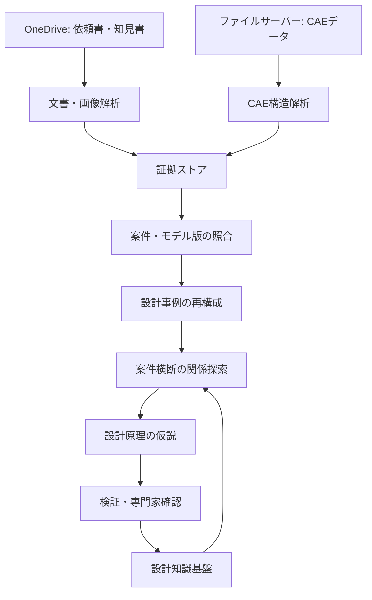

# AIによる設計知識基盤の構築構想

> ステータス：構想段階 / v0.1

## 1. 目的

過去の解析依頼書、解析知見書、CAEモデルを横断的に活用し、未知の設計問題に適用可能な設計知識を構築する。単なる文書検索や過去の設計者の模倣ではなく、証拠に基づく設計原理の発見・検証・更新を目指す。

自律化の対象はデジタルエンジニアリングとする。CAE等によるデジタル検証と、実機試験等による物理的バリデーションを分離し、後者は人間との協働領域とする。

## 2. 現状と課題

| データソース | 保有情報 | 課題 |
|---|---|---|
| OneDrive | 解析依頼書、解析知見書（Word、PowerPoint、Excel） | 画像中心、記述形式が不統一、判断理由の欠落 |
| ファイルサーバー | CAEプリ処理設定、モデル、一部の結果データ | 結果データが少ない、文書との対応関係が不明 |

設計者の意思決定、評価基準、棄却案、優先順位は暗黙知化している。構築担当者自身が設計専門家ではないことも前提とする。

## 3. 基本思想

- 過去の知見は正解集ではなく、設計原理を発見するための観測データである。
- 過去に成功した設計が現在の条件でも最適とは限らない。
- 単一文書の情報だけでなく、複数事例の共通点、相違点、矛盾、適用条件に価値がある。
- 設計者の実際の意図と、AIが推定した合理的な説明を区別する。記録されていない真意は一意に復元できない。
- 事実、推論、検証済み知見を分離し、すべてに出典と確認状態を付与する。
- 不明な情報を推測で埋めず、未解決事項として管理する。

### 抽象と具体の往復


## 4. 全体アーキテクチャ



原本は保全し、抽出・推論結果は派生データとして管理する。初期段階はリレーショナルDBと検索インデックスで開始し、関係性の要件が明確になってからグラフDBを検討する。

## 5. データソース別処理

### 5.1 Office文書

ネイティブ構造と視覚表現を併用する。テキスト、表、セル、図形、埋め込み画像、注釈、ページ画像を取得し、VLMに周辺文脈とともに解釈させる。

抽出対象：解析目的、要求条件、対象部品、変更内容、比較条件、観測結果、考察、明記された判断理由。コンター図では凡例、単位、変形倍率、評価部位、比較条件を確認する。色だけから合否を判定しない。

出典はファイルID・版・ページ・スライド・セル範囲・画像領域などで追跡可能にする。

### 5.2 CAEデータ

CAEソフト固有のAPI・パーサーを優先し、形状、材料、物性、荷重、拘束、接触、メッシュ、解析種別、出力設定、モデル差分を抽出する。結果が存在する場合は数値、単位、評価位置、解析ケースを取得する。

設定が存在するだけでは解析成功や合格を意味しない。再解析には入力の完全性、ソルバー版、ライセンス、計算資源を確認する。再計算結果は過去の実行結果と区別する。

## 6. 個別プロジェクトの処理方針

固定された工程を全案件に強制しない。エージェントには目的、利用可能なツール、品質制約、停止条件を与え、証拠の状態に応じて処理を選択させる。

| 入力の状態 | 処理方針 |
|---|---|
| 文書のみ | 目的・報告された結果・不足情報を抽出 |
| CAE設定のみ | 設定・モデル差分を取得。意図や結果は未確認とする |
| 文書＋設定 | 案件・モデル版を照合し、条件と報告結果を関連付ける |
| 結果も存在 | 報告書と数値・評価条件の整合性を確認 |
| 証拠不足 | 追加資料探索、確認質問、再解析候補を生成 |

決定的に取得できる数値や設定はプログラムで処理し、曖昧な画像解釈や仮説生成にはLLM/VLMを用いる。高コストな再解析は価値・不確実性・予算に基づき選択する。

### エージェントの完了条件

- 確認できた事実に出典がある。
- 紐付けの根拠と確認状態が記録されている。
- 推論と事実が分離されている。
- 不足情報と次の検証候補が記録されている。

情報不足による部分完了も許容する。

## 7. 知識の基本単位と関係付け

プロジェクト全体を一つの知見に圧縮せず、個々の設計変更・比較・判断を基本単位とする。

### 設計事例のスキーマ案

```yaml
case_id: example-001
project_id: unknown
objective: 割れの抑制
requirements: []
constraints: []
model_versions: []
changes: []
observations: []
reported_conclusions: []
explicit_rationale: null
hypotheses: []
alternatives: []
evidence_refs: []
verification_status: unverified
missing_information: []
```

各観測・仮説には個別の出典、抽出方法、確認状態を保持する。上記は例示であり実データではない。

### 案件内の関連付け

依頼番号、部品番号、モデル名、ファイルパス、日時、担当者、版を照合する。候補リンクと確認済みリンクを区別し、誤結合を修正できるようにする。

### 案件横断の関連付け

意味検索と構造化属性による検索を併用し、物理現象、形状、材料、荷重、対策、結果の関係を探索する。類似性は因果関係の証明ではない。反例や失敗例も積極的に探索し、適用範囲を明確にする。

## 8. 知識の検証と更新

知見は、観測事実 → 仮説 → デジタル検証済み → 必要に応じ物理的バリデーション済み、という確認状態を管理する。専門家による意図の確認は、物理的因果の検証とは別に記録する。

過去の設計者の判断を絶対的な正解とせず、未知の問題への転用能力を評価する。CAE検証の成立条件、モデルの妥当性、反例、他性能へのトレードオフも記録する。

## 9. 推進ロードマップ

| フェーズ | 実施内容 | 評価・成果 |
|---|---|---|
| 0 | データ実態調査 | ファイル形式、識別子、欠損率、アクセス権限 |
| 1 | 関連する20〜30案件程度で試行 | 事実抽出精度、モデル照合精度、設計事例カード |
| 2 | 案件横断の仮説生成 | 共通原理、反例、適用条件、専門家確認 |
| 3 | 未知案件への適用 | 知識なし・単純RAG・構造化知識ありの比較 |
| 4 | 全量処理・継続更新 | 差分取得、品質監視、知識の版管理 |

案件数は初期目安。関連する部品群を優先し、資料の揃い方が異なる案件を含める。評価用案件は知識構築用データから分離する。

### 最初のPoCの問い

設計者が整理していない複数の解析資料とCAEデータから、AIが設計変更の目的・条件・結果を再構成し、検証可能な設計原理の仮説を少なくとも一つ導けるか。

## 10. 将来の知識収集

過去資料の復元だけに依存せず、今後の設計レビューや会議で目的、制約、選択肢、棄却理由、意思決定を鮮度の高いうちに記録する。AIは不足情報を検出し、必要な確認を促す。原本と要約を紐付け、圧縮によるコンテキスト消失を防ぐ。

## 11. セキュリティ・運用

社内機密データの送信可否、原本のアクセス権限継承、派生データのアクセス制御、監査ログ、保存期間を定義する。GitHubには原則として構想・コード・スキーマのみを置き、実際の設計データや社内識別子は承認なしに登録しない。

## 12. 未解決事項

- CAEソフト名、ファイル形式、APIの利用可否
- 文書とモデルを照合する識別子の有無
- 結果データの残存率、再解析可能率
- 設計事例の粒度と専門領域別スキーマ
- 専門家レビューの体制と評価基準
- モデル選定、処理コスト、再解析予算
- デジタル検証器の構築範囲と物理的バリデーションへの接続

## 13. 設計方針の要約

過去の知見を無条件に継承するのではなく、原本を証拠として保全し、個別案件を再構成し、案件横断で仮説を生成し、検証によって設計原理を更新する。処理経路には自由度を持たせ、証拠管理と品質基準は共通化する。
